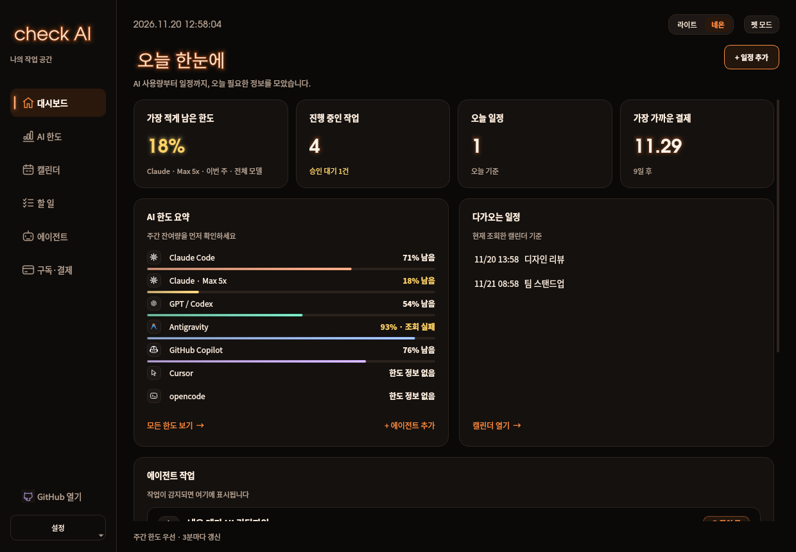
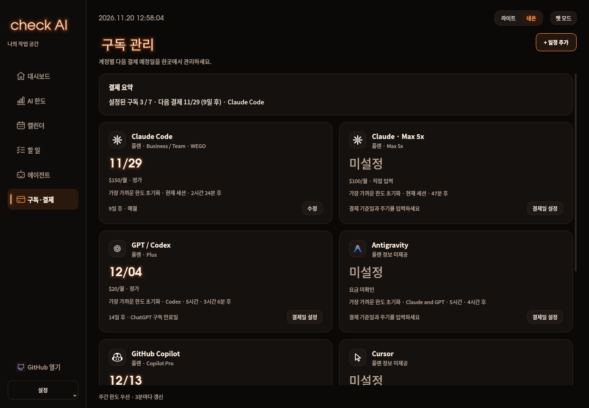
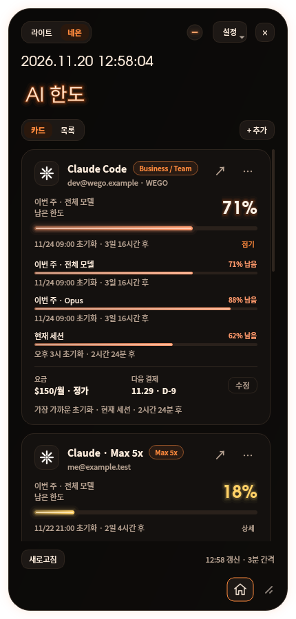
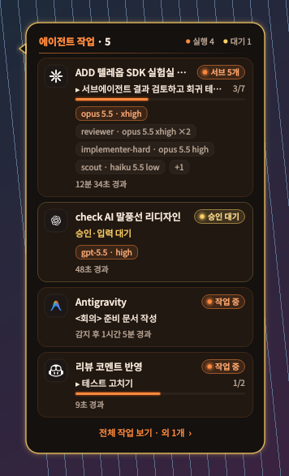
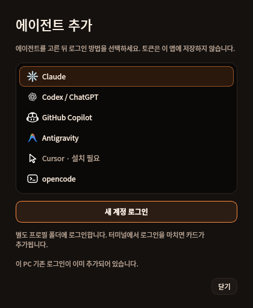

<p align="center">
  
</p>

<p align="center"><a href="README.md">한국어</a> · <b>English</b></p>

# AIpet (check AI)

A tiny pixel mascot on my desktop that tells me how much AI quota is left, what my agents are doing, and what's next on my calendar.

<p align="center"><br><a href="docs/media/intro.mp4">Intro video (MP4)</a></p>

<p align="center"></p>

I switch between Claude Code, Codex, Antigravity and Copilot, and I kept opening windows just to check quotas, see whether an
agent was still working, or find my next meeting. So I put it all in one widget. It's a PySide6 app for Ubuntu GNOME (X11), it
runs on my desktop every day, and it's styled like an orange neon sign on a dark wall.

What it does:

- **Accounts you add yourself** — nothing shows up on its own. Press **+ 에이전트 추가**, pick Claude, Codex, Copilot,
  Antigravity, Cursor or opencode, then either log in to a new account or link the login already on this PC. Several accounts of
  the same service work, and each card can be removed from its menu. No tokens are stored; each account gets its own profile
  folder and the widget just calls that agent's CLI, read-only.
- **Quotas and billing** — remaining share and reset time, refreshed every 3 minutes. Each card shows the plan, monthly price
  (list price or your own), next payment date with a D-day, and the nearest reset. The Codex payment date is read automatically;
  the others you enter once.
- **Agent sessions** — reads local Claude Code, Codex, Copilot, Antigravity and opencode logs every 5 seconds and shows the
  session name, model and reasoning effort, the current task (n/m), and running subagents (e.g. `Explore · haiku 5.5 · low`).
  Click one to jump to that agent's window.
- **Google Calendar** — today, tomorrow and the next 7 days; add, edit, delete; Korean quick-add like `내일 오후 3시 회의`
  ("meeting tomorrow 3 pm"). The parser is a small regex grammar, not an LLM, and always shows a preview before saving.
- **Todos and notifications** — a local todo list; alerts 10 minutes before an event and at 20% / 10% quota left, never twice.
- **The pet** — folds into an always-on-top Claude pixel mascot with 9 animations: idle, walking, waving, jumping, failing,
  looking around (waiting), typing on a laptop (working) and a happy result hop. At rest it mostly sits still, blinks and
  glances, and every 15-60 s does a random fidget (look around, hop, stretch, arm wiggle, stroll, sit down...); left alone
  long enough it dozes off until you hover it. Hovered, its eyes follow the cursor; while agents work it types with the
  odd look-up or stretch. Neon or light theme, widget and bubble transparency, reduced motion. The agent bubble shows one card per session with status, todo progress and model/effort.

Hover over the folded pet for your next event, the last quota check and running sessions. Right-click for an animation preview
and quick-add. `widget.py --desktop` opens a wide app window with a sidebar.

A few things I cared about while building it:

- If an event insert gets no response and you click again, it reuses the same event id. A 409 means it already exists, so the widget re-reads it instead of making a duplicate.
- Closing a login before it finishes removes the half-made profile folder. Removing an account deletes its folder only when you tick the box, and only folders the app created.
- The neon glow is painted directly instead of stacking graphics effects, so it stays light.
- A file lock plus a local socket keeps it to one instance. Clicking the shortcut again brings the running window forward.

## Screens

Rendered with sample data.

| Dashboard | AI quotas |
|---|---|
|  |  |
| **Agent sessions** | **Billing** |
|  |  |

| Compact widget | Agent bubble | Add an agent |
|---|---|---|
|  |  |  |

Light theme: [docs/screenshots/light-dashboard.png](docs/screenshots/light-dashboard.png)

A screen-by-screen guide (Korean) is in [docs/GUIDE.md](docs/GUIDE.md).

## Run

Needs Ubuntu GNOME (X11), Python 3, PySide6 and the agent CLIs you want (`claude`, `codex`, `gh`, `agy`, `opencode`, ...).
The Google OAuth helpers are vendored in `vendor/`. Login terminals need `terminator`, `x-terminal-emulator` or `gnome-terminal`.
`rtk` is optional: when installed, CLIs run through `rtk proxy`; otherwise they run directly.

```bash
git clone https://github.com/lsy041015/AIpet.git ~/ai-quota-widget
cd ~/ai-quota-widget

python3 widget.py                      # run the widget
python3 widget.py --desktop            # wide app window
python3 widget.py --check              # read live quotas of registered accounts without a window
QT_QPA_PLATFORM=offscreen python3 -m unittest discover -v                        # 194 tests
QT_QPA_PLATFORM=offscreen python3 widget.py --smoke /tmp/check-ai.png --theme light   # render the UI to an image
```

For the calendar, enable the Calendar API in a Google Cloud project, download a **Desktop app** OAuth client JSON, and pick it
in the widget's **Google 연결** dialog. It only asks for the `calendar.events.owned` scope and keeps the token locally with mode `0600`.

## Rough edges

X11 only, so no Wayland, Windows or macOS. The Copilot quota relies on an internal API the official extension uses, so it may
break if the response changes. Antigravity (`agy`) has no login command (only the in-app `/login`) and keeps a single login in the system keyring, so **Antigravity 계정 바꾸기** opens `agy` in a terminal and your `/login` replaces this PC's Antigravity account instead of adding one; Cursor and opencode show
no quota. Claude Team seat prices can't be told apart, so enter yours by hand, and an expired login is renewed with **다시 로그인** in the card menu, which keeps the same card.

Service logos are used only to identify each service ([assets/SOURCES.md](assets/SOURCES.md)). The pet is drawn in code,
modeled on Anthropic's Claude mascot (no image file). It's a personal project, so there's no license file.

<sub>[More projects](https://github.com/lsy041015)</sub>
