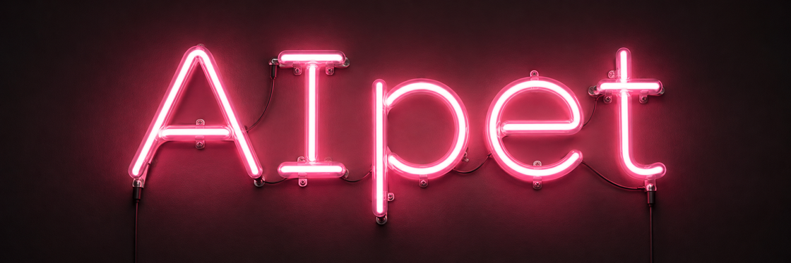

<p align="center">
  
</p>

<p align="center"><a href="README.md">한국어</a> · <b>English</b></p>

# AIpet (check AI)

A tiny pixel computer on my desktop that tells me how much AI quota is left, what my agents are doing, and what's next on my calendar.

I switch between Codex, Antigravity and Copilot, and I kept opening windows just to check quotas, see whether an agent was
still working, or find my next meeting. So I put all three in one widget. It's a PySide6 app for Ubuntu GNOME (X11), and it
runs on my desktop every day.

What it does:

- **AI quotas** — remaining share and reset time per service, refreshed every 3 minutes. It stores no tokens; it just calls the
  `codex`, `agy` and `gh` CLIs you're already logged in to, read-only.
- **Agent bubbles** — reads local Codex, Copilot and Antigravity logs every 5 seconds and shows things like "editing files" or
  "running a command". Click one to jump to that agent's window. A running process alone never counts as "working".
- **Google Calendar** — today, tomorrow and the next 7 days; add, edit, delete; Korean quick-add like `내일 오후 3시 회의`
  ("meeting tomorrow 3 pm"). The parser is a small regex grammar, not an LLM, and always shows a preview before saving.
- **Notifications** — 10 minutes before an event, and at 20% / 10% quota left. Never twice for the same thing.
- **The pet** — folds into a small always-on-top circle and plays 9 animations depending on state. Light/dark theme and
  transparency are adjustable too.

Hover over the folded pet and a bubble shows your next event and the last quota check. A blue clock appears when an event
starts within 10 minutes, and an orange badge when a service is at 20% or less. Right-click for an animation preview and quick-add.

A few things I cared about while building it:

- If an event insert gets no response and you click again, it reuses the same event id. A 409 means it already exists, so the widget re-reads it instead of making a duplicate.
- The pet sprite file is untouched. Colors are swapped only while drawing (beige to white, green to sky blue).
- A file lock plus a local socket keeps it to one instance. Clicking the shortcut again brings the running window forward instead of opening a new one.

## Run

Needs Ubuntu GNOME (X11), Python 3, PySide6 and logged-in `codex`, `agy`, `gh`. The Google OAuth helpers are vendored in `vendor/`.

```bash
git clone https://github.com/lsy041015/AIpet.git ~/ai-quota-widget
cd ~/ai-quota-widget

python3 widget.py                      # run the widget
python3 widget.py --check              # read live quotas without opening a window
QT_QPA_PLATFORM=offscreen python3 -m unittest discover -v                        # 54 tests
QT_QPA_PLATFORM=offscreen python3 widget.py --smoke /tmp/check-ai.png --theme light   # render the UI to an image
```

For the calendar, enable the Calendar API in a Google Cloud project, download a **Desktop app** OAuth client JSON, and pick it
in the widget's **Google 연결** dialog. It only asks for the `calendar.events.owned` scope and keeps the token locally with mode `0600`.

## Rough edges

X11 only, so no Wayland, Windows or macOS. The Copilot quota relies on an internal API the official extension uses, so it may
break if the response changes. Approval screens that aren't logged and shared calendars aren't handled yet.

Service logos are used only to identify each service ([assets/SOURCES.md](assets/SOURCES.md)). The pet isn't my art: it's a
copy of the Codex CLI `tiny-crt` pet by OpenAI ([assets/TINY-CRT-SOURCE.md](assets/TINY-CRT-SOURCE.md)). It's a personal
project, so there's no license file.

<sub>[More projects](https://github.com/lsy041015)</sub>
