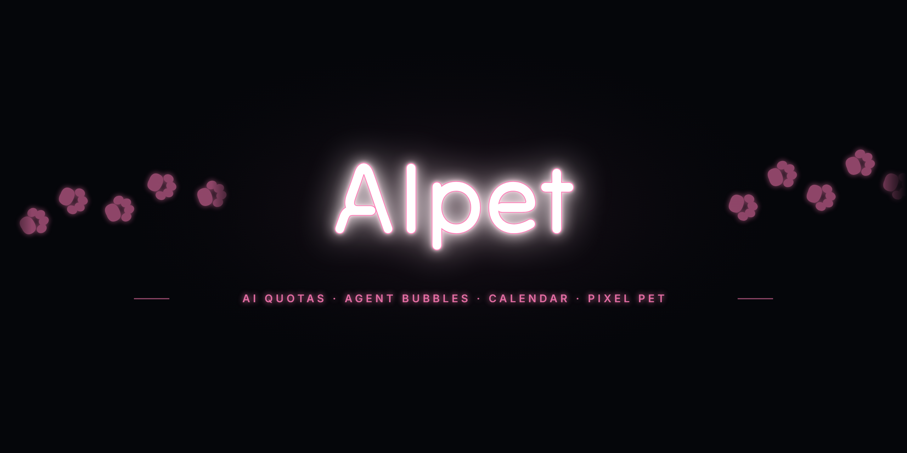
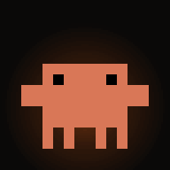
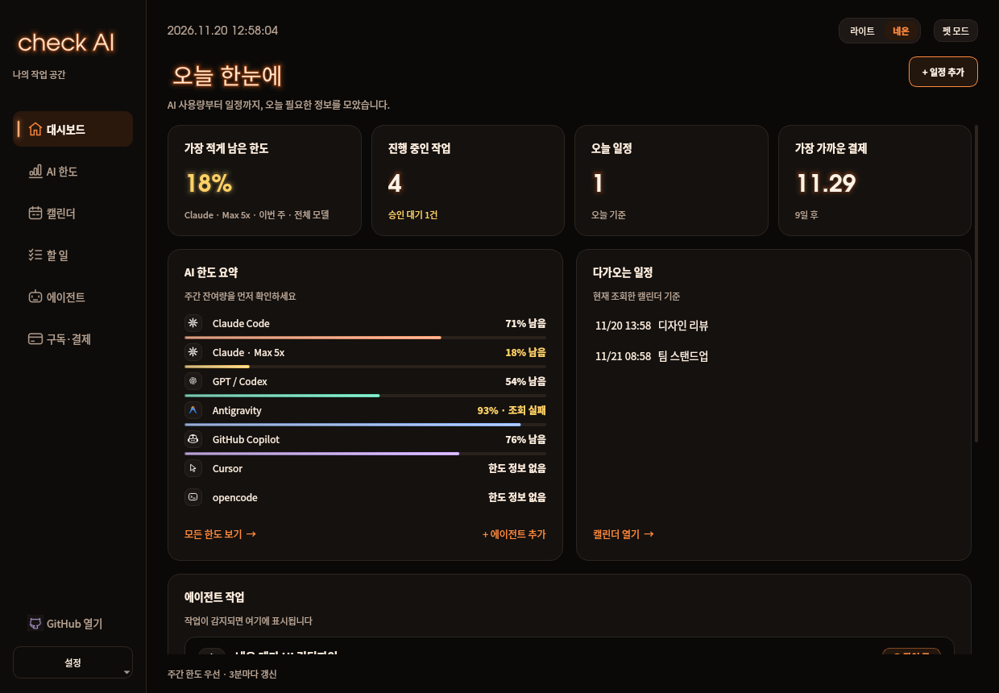
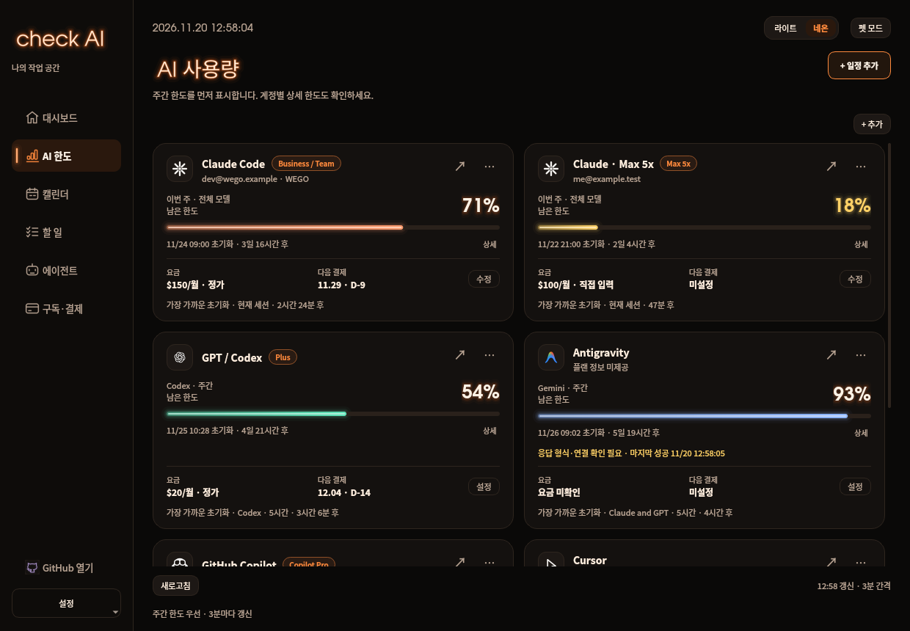
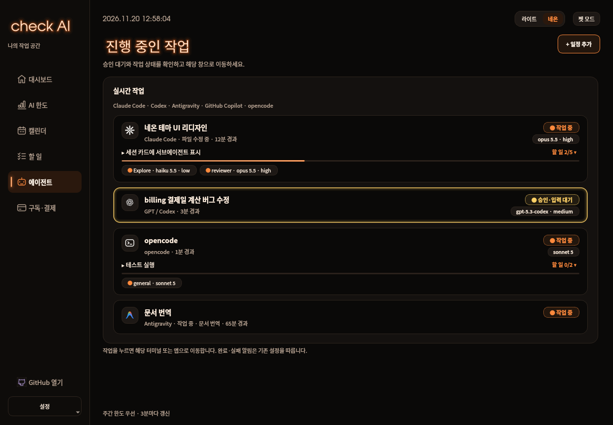
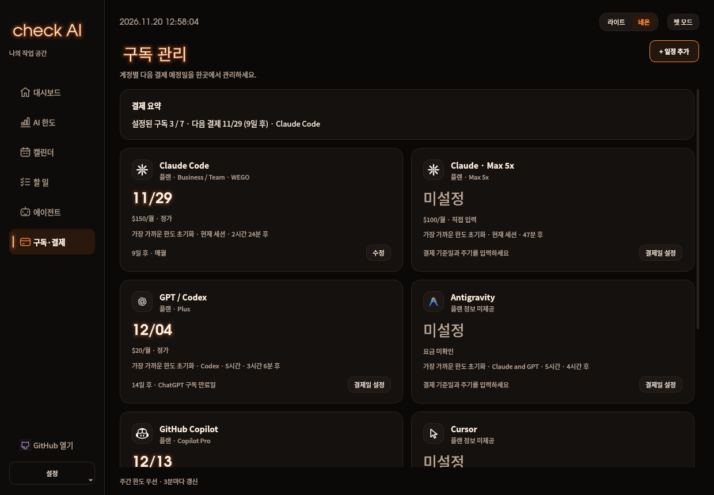
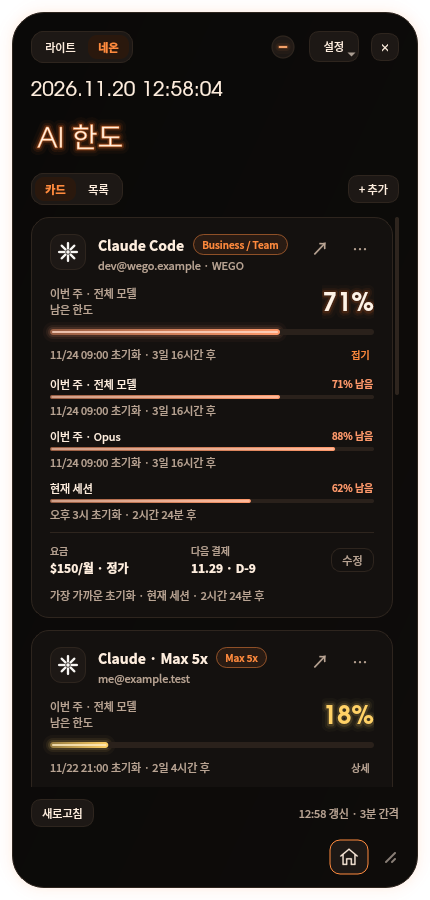
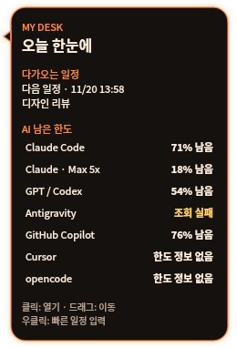
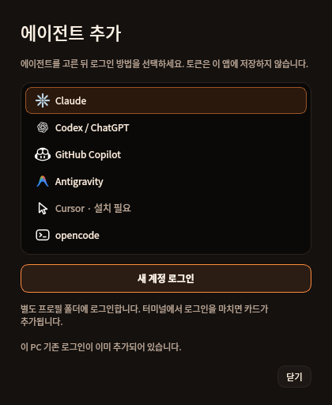

<p align="center">
  
</p>

<p align="center"><b>한국어</b> · <a href="README.en.md">English</a></p>

# AIpet (check AI)

바탕화면에 사는 작은 도트 마스코트가 AI 한도, 돌아가는 에이전트, 다음 일정을 알려 줘요.

<p align="center"></p>

Claude Code, Codex, Antigravity, Copilot을 번갈아 쓰다 보니 한도가 얼마 남았는지, 에이전트가 아직 일하는 중인지, 다음 회의가 언제인지
확인하려고 창을 계속 열게 되더라고요. 그래서 위젯 하나에 모았어요. Ubuntu GNOME(X11)에서 PySide6로 만들었고,
제 데스크톱에서 매일 켜 두고 씁니다. 화면은 어두운 벽에 켜진 주황 네온사인 느낌으로 꾸몄어요.

할 수 있는 것:

- **계정 직접 추가** — 처음엔 아무것도 없어요. **+ 에이전트 추가**에서 Claude·Codex·Copilot·Antigravity·Cursor·opencode 중
  하나를 고르고, 새 계정으로 로그인하거나 이 PC에 이미 로그인된 계정을 연결하면 그때부터 카드가 생겨요. 같은 서비스의
  계정 여러 개도 되고, 카드 메뉴에서 지울 수 있어요. 토큰은 저장하지 않고, 계정마다 따로 둔 프로필 폴더로 각 CLI를 불러 조회만 해요.
- **AI 한도와 결제 정보** — 남은 비율과 초기화 시각을 3분마다 갱신해요. 카드마다 플랜, 월 요금(정가 또는 직접 입력),
  다음 결제일과 D-day, 가장 가까운 초기화가 나와요. Codex 결제일은 자동으로, 나머지는 직접 입력해요.
- **에이전트 세션** — Claude Code·Codex·Copilot·Antigravity·opencode의 로컬 기록을 5초마다 읽어서 세션 이름, 모델·추론강도,
  진행 중인 작업 항목(n/m), 돌고 있는 서브에이전트(예: `Explore · haiku 5.5 · low`)를 보여 줘요. 누르면 그 에이전트 창으로 넘어가요.
- **Google Calendar** — 오늘·내일·7일 일정 보기, 추가·수정·삭제, `내일 오후 3시 회의` 같은 한국어 빠른 입력.
  빠른 입력은 LLM이 아니라 작은 정규식 문법이고, 저장 전에 꼭 미리보기를 보여 줘요.
- **할 일과 알림** — 이 PC에 저장되는 할 일 목록. 일정 10분 전, 한도 20%·10% 남았을 때 알림. 같은 알림은 두 번 안 보내요.
- **펫** — 접으면 항상 위에 떠 있는 Claude 도트 마스코트가 돼요. 대기, 걷기, 손 흔들기, 점프, 실패, 두리번(확인 대기),
  노트북 타이핑(작업 중), 결과 확인 9가지 상태 동작을 해요. 쉴 때는 가만히 눈을 깜빡이고 가끔 흘끗 보다가, 15~60초마다
  두리번거리기, 콩 뛰기, 기지개, 팔 흔들기, 산책, 앉기 같은 잔동작을 무작위로 하고, 오래 두면 앉아서 졸아요(마우스를 올리면 깨요).
  마우스를 올리면 커서 쪽을 쳐다보고, 작업 중에도 가끔 고개를 들어 쳐다보거나 기지개를 켜요.
  네온·라이트 테마, 투명도, 동작 줄이기를 고를 수 있어요.

접힌 펫에 마우스를 올리면 다음 일정, 마지막 한도 조회 결과, 지금 돌아가는 세션이 말풍선으로 나와요. 우클릭하면 애니메이션
미리보기와 빠른 일정 입력을 고를 수 있어요. `widget.py --desktop`으로 사이드바가 있는 넓은 앱 화면도 열 수 있어요.

만들면서 신경 쓴 것도 몇 가지 있어요.

- 일정 추가 응답을 못 받아서 다시 눌러도 같은 이벤트 ID로 보내요. 서버가 409를 주면 새로 만들지 않고 그 일정을 다시 읽어 와요.
- 로그인을 끝내지 않고 창을 닫으면 만들다 만 프로필 폴더를 지워요. 계정을 지울 때 폴더 삭제는 체크했을 때만, 그리고 앱이 만든 폴더만 지워요.
- 네온 발광은 그래픽 효과를 겹치지 않고 직접 그려서 가볍게 유지했어요.
- 파일 잠금과 로컬 소켓으로 한 번만 실행돼요. 바로가기를 또 누르면 새 창 대신 떠 있는 창을 앞으로 가져와요.

## 화면

예시 데이터로 렌더링한 화면이에요.

| 대시보드 | AI 한도 |
|---|---|
|  |  |
| **에이전트 세션** | **구독·결제** |
|  |  |

| 작은 위젯 | 펫 말풍선 | 에이전트 추가 |
|---|---|---|
|  |  |  |

라이트 테마: [docs/screenshots/light-dashboard.png](docs/screenshots/light-dashboard.png)

자세한 화면별 설명은 [docs/GUIDE.md](docs/GUIDE.md)에 있어요.

## 실행

필요한 것: Ubuntu GNOME(X11), Python 3, PySide6, 그리고 쓰려는 에이전트 CLI(`claude`, `codex`, `gh`, `agy`, `opencode` 등).
Google OAuth 라이브러리는 `vendor/`에 넣어 뒀어요.

```bash
git clone https://github.com/lsy041015/AIpet.git ~/ai-quota-widget
cd ~/ai-quota-widget

python3 widget.py                      # 위젯 실행
python3 widget.py --desktop            # 넓은 앱 화면
python3 widget.py --check              # 창 없이 등록된 계정의 실제 한도만 조회
QT_QPA_PLATFORM=offscreen python3 -m unittest discover -v                        # 테스트 167개
QT_QPA_PLATFORM=offscreen python3 widget.py --smoke /tmp/check-ai.png --theme light   # 화면을 이미지로 렌더링
```

캘린더를 쓰려면 Google Cloud 프로젝트에서 Calendar API를 켜고 **데스크톱 앱** OAuth 클라이언트 JSON을 받은 다음,
위젯의 **Google 연결** 창에서 그 파일을 고르면 돼요([설정 안내](https://developers.google.com/workspace/calendar/api/quickstart/python?hl=ko)).
권한은 `calendar.events.owned`만 요청하고, 토큰은 `0600` 권한으로 로컬에 저장해요.

## 아쉬운 점

X11 전용이라 Wayland, Windows, macOS에서는 안 돌아가요. Copilot 한도는 공식 확장이 쓰는 내부 API에 기대고 있어서
응답 형식이 바뀌면 고쳐야 할 수 있어요. Antigravity(`agy`)는 로그인 명령이 없고(앱 안의 `/login`만 있음) 로그인 정보를 시스템 키링에 하나만 저장해요. 그래서 **Antigravity 계정 바꾸기**를 누르면 터미널에 `agy`가 열리고, `/login`을 마치면 계정이 추가되는 게 아니라 이 PC의 Antigravity 계정이 바뀌어요. Cursor·opencode는 한도를
못 읽어요. Claude Team 좌석 요금은 구분이 안 돼서 직접 입력해야 하고, 로그인이 만료된 계정은 지우고 다시 추가해야 해요.

서비스 로고는 식별용으로만 써요([assets/SOURCES.md](assets/SOURCES.md)). 펫은 Anthropic의 Claude 마스코트를 참고해서
코드로 직접 그린 도트예요(그림 파일 없음). 개인 프로젝트라 라이선스 파일은 없어요.

<sub>[다른 프로젝트 보기](https://github.com/lsy041015)</sub>
